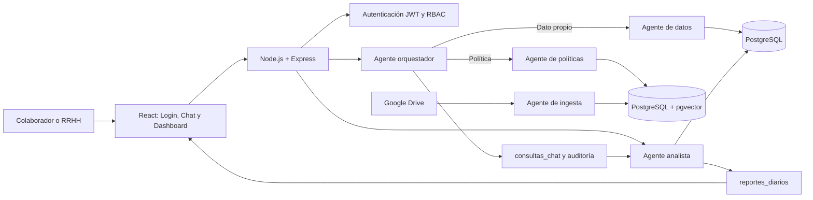

# Arquitectura del portal

## Controles clave

- El agente de políticas no consulta tablas personales.
- El agente de datos filtra por el usuario autenticado.
- El dashboard requiere el rol `RRHH`.
- El resumen del reporte parte de un JSON SQL y no genera cifras nuevas.
- Las consultas restringidas se rechazan y se registran.
